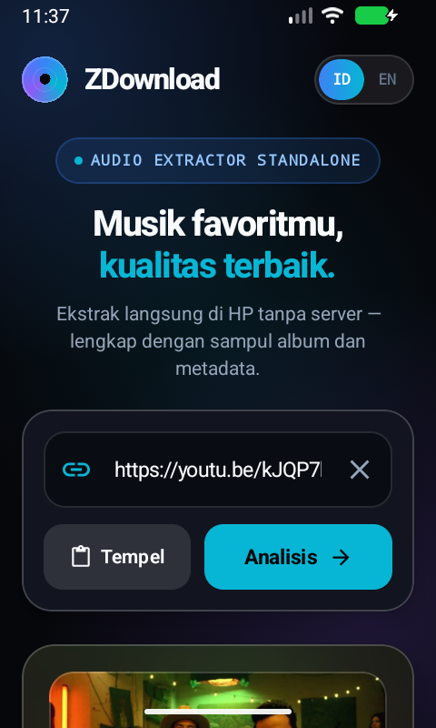
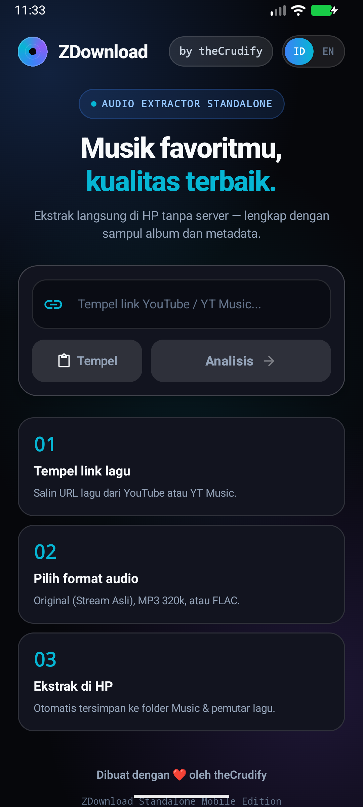
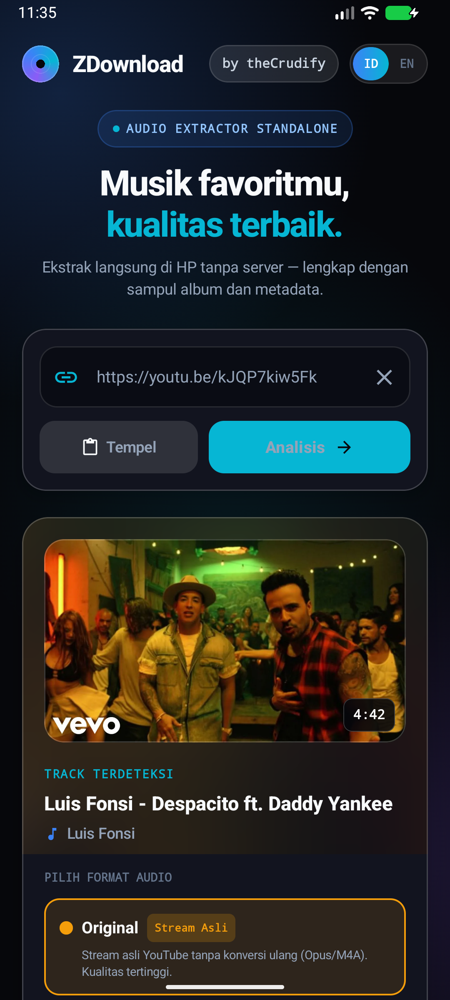
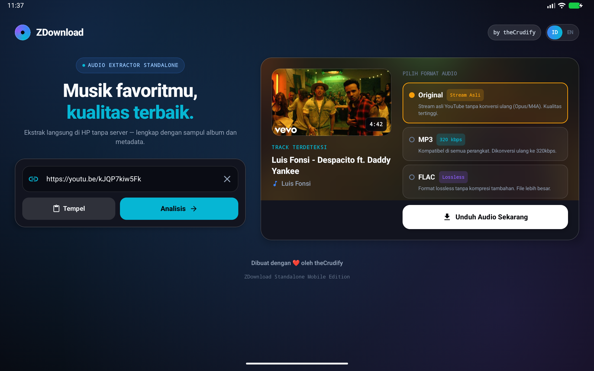
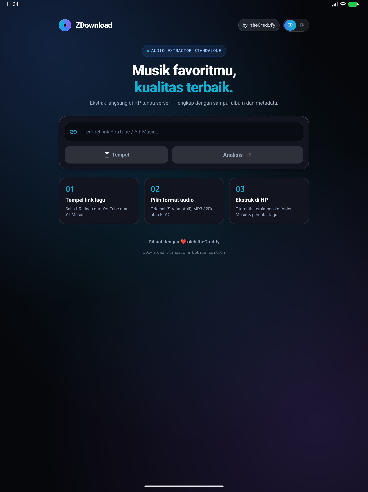

# ZDownload — Native Android Edition

A 100% standalone **Native Android App** to extract and download high-quality audio from YouTube and YouTube Music.

Crafted with ❤️ by **[theCrudify](https://github.com/theCrudify)**.

---

## Highlights

- 📱 **100% Standalone & Offline Engine**: Runs `yt-dlp` and `FFmpeg` directly on the Android device via native ARM/ARM64 libraries. **No backend server required**.
- 🎨 **Modern Jetpack Compose UI**: Dark Material 3 aesthetic matching the ZDownload web design (glassmorphism, smooth animations, vinyl disc spin, live equalizer visualizer).
- 🎚️ **3 Formats Supported**:
  - **Original** (Untouched Opus/M4A stream, highest quality)
  - **MP3 320 kbps** (Universal compatibility)
  - **FLAC Lossless** (Hi-Fi container)
- 🖼️ **Album Art & Metadata**: Embedded automatically into every audio file.
- 🔗 **Direct Share Sheet Integration**: Open YouTube or YouTube Music app, tap **Share** on any track, and choose **ZDownload** to instantly load and download it!
- 📂 **Auto Music Library Sync**: Saved directly to `/Music/ZDownload` on device storage and indexed into Android MediaStore (shows up instantly in Spotify local files, Samsung Music, VLC, etc.).

---

## Screenshots

| Phone 4" (320dp) | Phone 6" | Phone 6" — track loaded |
|:---:|:---:|:---:|
|  |  |  |

| Tablet 11" landscape — two-pane | Tablet 13" portrait |
|:---:|:---:|
|  |  |

---

## Responsive Layout

One screen (`HomeScreen.kt`) adapts to the available width via `BoxWithConstraints`:

| Width | Typical device | Layout |
|---|---|---|
| `< 360dp` | 4"–4.7" phones | Single column, 26sp title, 16dp gutters, creator pill hidden (footer still credits) |
| `360–599dp` | 5"–6.7" phones | Single column, 32sp title |
| `≥ 600dp` portrait | 7"–13" tablets | Centered column (max 760dp), 40sp title, 3-column step cards, 2-column track card |
| `≥ 840dp` **and** landscape | Tablets landscape, phones landscape | **Two-pane**: hero + input left (42%), steps / track / result right (58%), max 1280dp |

Content is drawn edge-to-edge (`enableEdgeToEdge()`), with status/navigation bar insets applied as padding.

---

## Requirements

- **Android Studio** (Koala / Ladybug or newer)
- **JDK 17 or 21** (Gradle 8.7 does not run on JDK 25)
- **Android SDK** API 24+ (Android 7.0 Nougat up to Android 15 / 16)

---

## How to Open & Run

1. Open **Android Studio**.
2. Click **Open** and select this directory:
   ```
   00. Youtube Music ZDownload Android
   ```
3. Let Gradle sync dependencies (Internet required on first sync to download Gradle wrapper and youtubedl-android dependencies).
4. Connect an Android phone via USB (or start an Android Emulator).
5. Click the **Run** ▶️ button in Android Studio.

---

## How to Build Standalone APK

From the command line:
```bash
./gradlew assembleDebug        # Windows: gradlew.bat assembleDebug
# output: app/build/outputs/apk/debug/app-debug.apk
```

Or in Android Studio:

1. Go to **Build** menu > **Build Bundle(s) / APK(s)** > **Build APK(s)**.
2. Once finished, click **locate** to get the generated `app-debug.apk`.
3. Transfer the `.apk` to any Android phone and install!

---

## Project Architecture

```
00. Youtube Music ZDownload Android/
├── app/
│   ├── src/main/
│   │   ├── AndroidManifest.xml
│   │   ├── java/com/thecrudify/zdownload/
│   │   │   ├── ZDownloadApp.kt              # Initializes YoutubeDL & FFmpeg engines locally
│   │   │   ├── MainActivity.kt               # Main entry & YouTube share-intent handler
│   │   │   ├── data/
│   │   │   │   ├── model/                    # AudioFormat, TrackInfo, DownloadState
│   │   │   │   └── repository/               # Local on-device execution engine
│   │   │   ├── viewmodel/MainViewModel.kt   # State management & coroutines
│   │   │   └── ui/
│   │   │       ├── screens/home/             # Home screen, split per section:
│   │   │       │   ├── HomeScreen.kt         #   screen entry, layout & footer
│   │   │       │   ├── HomeHeader.kt         #   top bar, language switch, hero
│   │   │       │   ├── InputSection.kt       #   URL input & idle steps
│   │   │       │   ├── TrackDetailsCard.kt   #   track info, format picker, download button
│   │   │       │   ├── ResultCards.kt        #   success & error cards
│   │   │       │   └── AmbientEffects.kt     #   background orbs & particle burst
│   │   │       ├── components/               # EqualizerVisualizer, etc.
│   │   │       └── theme/                    # Color palette, Typography, Theme
│   │   └── res/                              # Drawables, themes, strings, file_paths
│   └── build.gradle.kts                      # Dependencies & NDK ABI filters
├── docs/screenshots/                         # Responsive screenshots (legacy/ = pre-v1.1 UI)
├── CHANGELOG.md                              # Version history
├── releases/                                 # Prebuilt APKs (git-ignored)
├── gradle/
│   ├── libs.versions.toml                    # Version catalog (all dependency versions)
│   └── wrapper/                              # Gradle wrapper
├── build.gradle.kts                          # Root Gradle build script
├── settings.gradle.kts                       # Repository management (JitPack, Google, MavenCentral)
└── gradle.properties                         # JVM configuration
```

---

## Development Notes

### Build from the terminal
Gradle 8.7 does not run on JDK 25. If your default `java` is newer, point Gradle at JDK 17:
```bash
JAVA_HOME=/usr/lib/jvm/java-17-openjdk-amd64 ./gradlew assembleDebug
```
Android Studio uses its bundled JDK, so this only matters for the CLI.

### Dependencies
All versions live in `gradle/libs.versions.toml`. Upgrade a library by editing that one file.

### Testing other screen sizes on one emulator
```bash
adb shell wm size 480x800   && adb shell wm density 240   # ~4" phone (320dp wide)
adb shell wm size 2560x1600 && adb shell wm density 320   # 11" tablet landscape
adb shell wm size 2048x2732 && adb shell wm density 320   # 13" tablet portrait
adb shell wm size reset     && adb shell wm density reset # back to normal
```
Load a track without typing by sending a share intent:
```bash
adb shell am start -a android.intent.action.SEND -t text/plain \
  --es android.intent.extra.TEXT "https://youtu.be/<id>" \
  -n com.thecrudify.zdownload/.MainActivity
```

### Gotchas
- **No colors in `Type.kt`.** Material 3 applies `typography.bodyLarge` as the default text style; a color there overrides every `Button`'s `contentColor` (this once made button labels unreadable).
- **Modifier order for max width:** `widthIn(max = …)` must come *before* `fillMaxWidth()`, otherwise the cap is ignored.
- Text is bilingual (ID/EN) via `AppLanguage` inline in the composables, not `strings.xml` yet.

---

## Author & License

Developed with ❤️ by **theCrudify** ([@theCrudify](https://github.com/theCrudify)).
For personal educational use only.
