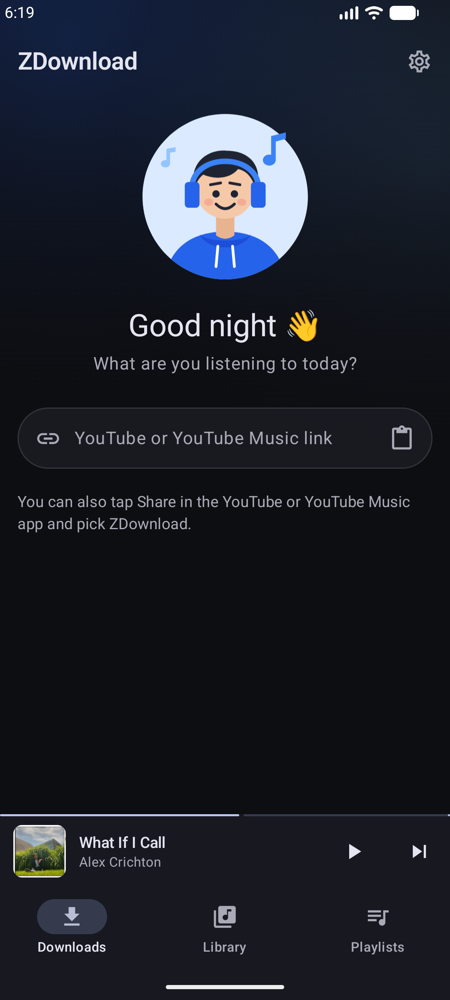
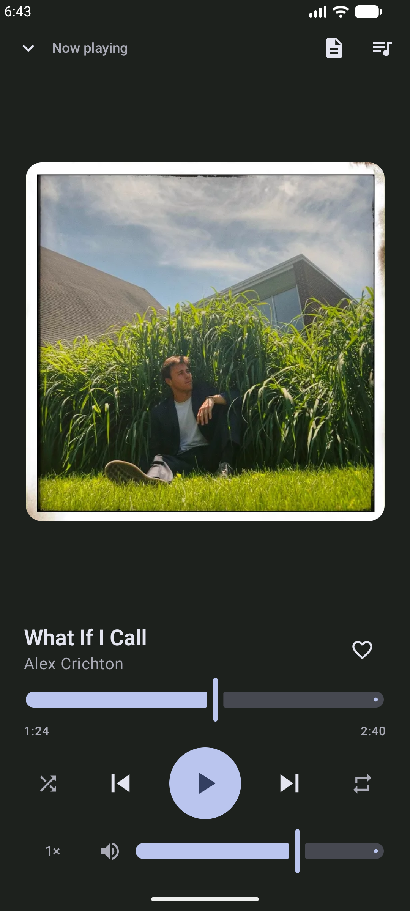
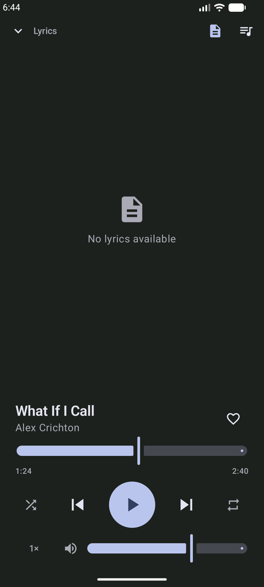
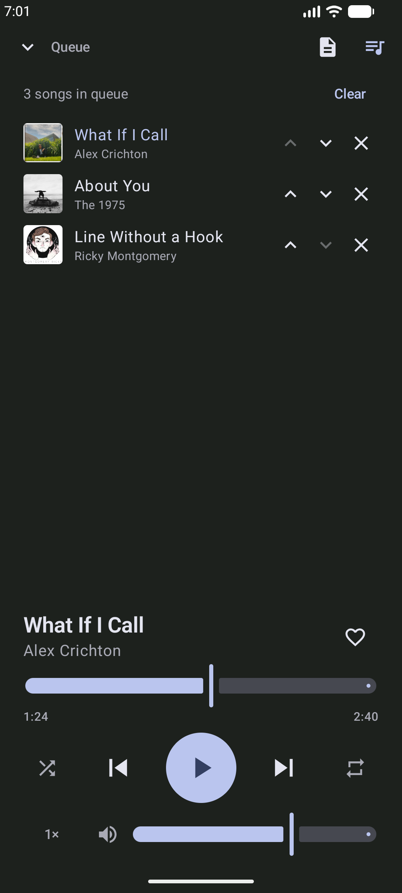
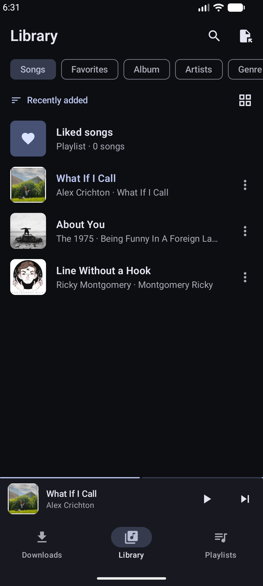
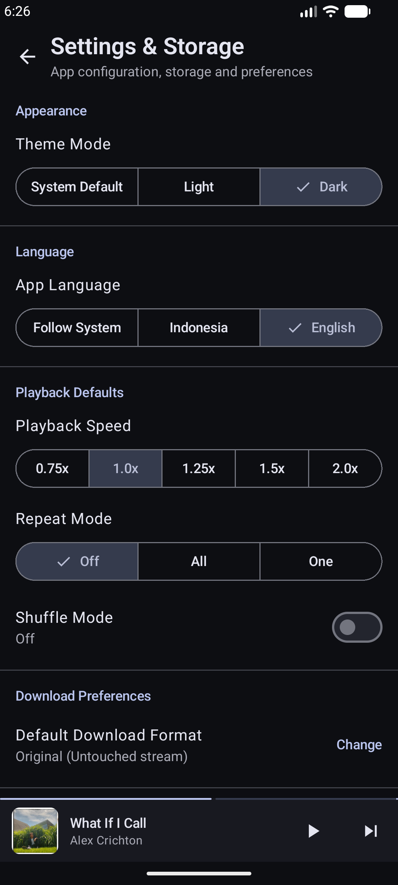
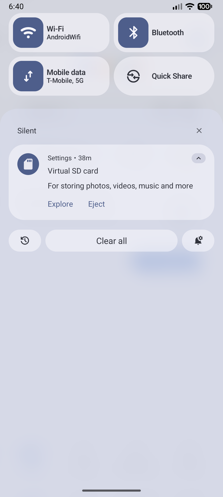
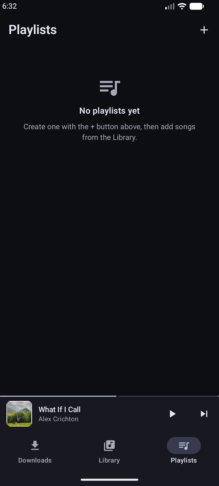
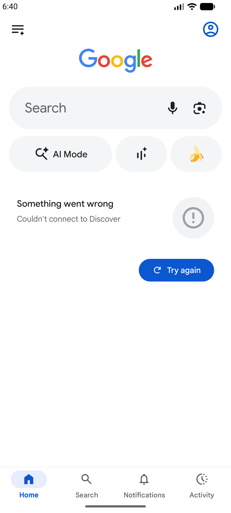
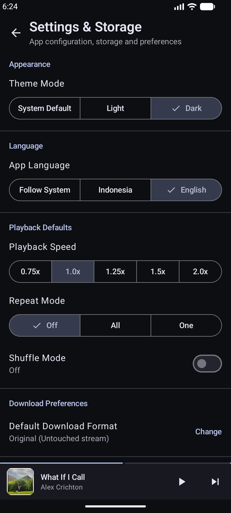

# ZDownload — Native Android Music Downloader & Offline Player

A 100% standalone **Native Android Application** combining a high-performance YouTube audio downloader with a complete, production-grade offline music player ecosystem.

Crafted with ❤️ by **[theCrudify](https://github.com/theCrudify)**.

---

## 🌟 Overview & Key Capabilities

ZDownload transforms your Android device into a self-contained music studio. It requires **no external backend servers or proxies** — running `yt-dlp` and `FFmpeg` directly on-device using native binaries, managing your library with an Android Room (SQLite) database, and powering high-fidelity playback with AndroidX Media3 ExoPlayer.

### 🎧 1. Professional Offline Music Player
- **AndroidX Media3 ExoPlayer Engine**: Seamless background playback with audio focus handling (headset unplug, incoming calls, ducking).
- **Notification & Lock Screen Media Controls**: Standard Android MediaStyle notifications with interactive playback controls, seekbar, and artwork display.
- **Playback Queue & History**: Persistent play queue, dynamic reordering, and playback history tracking.
- **Repeat & Shuffle**: Off, Repeat All, Repeat One, and true randomized shuffle modes.
- **Lyrics & Visualizer**: Synced lyrics viewer and ambient real-time audio visualizer effects.
- **Persistent State**: Automatically remembers last played track, position, speed, and volume across restarts.

### ⬇️ 2. Autonomous Background Download Manager
- **Foreground Service**: Reliable background downloads that survive app minimization and device sleep.
- **Real-Time Progress & Metrics**: Live download speed (kB/s, MB/s), progress percentages, and estimated time remaining (ETA).
- **Persistent Queue & History**: Queue management with pause, resume, cancel, retry, and duplicate prevention.
- **Auto Library Registration**: Extracted audio files are immediately registered into the local Room database and indexed into Android MediaStore.

### 🎚️ 3. Comprehensive Audio Format Support
Extract directly into your preferred format and quality:
- **Original Stream** (Best available untouched Opus / AAC / M4A source)
- **MP3** (320 kbps high-bitrate universal compatibility)
- **M4A / AAC** (Efficient high-fidelity Apple-compatible audio)
- **FLAC** (Lossless Hi-Fi audio container)
- **WAV** (Uncompressed PCM audio)
- **OPUS** (Modern ultra-efficient speech and music codec)

### 🏷️ 4. Metadata Engine & Tag Editor
- **Automatic Tag Extraction**: Reads duration, bitrate, sample rate, channels, artist, and album art on download or import.
- **In-App ID3 / Vorbis Tag Editor**: Edit Title, Artist, Album, Album Artist, Genre, Year, Track Number, and Lyrics.
- **Tag Writing**: Write tags directly into physical audio files (MP3, FLAC, M4A) via `jaudiotagger` or keep them locally in Room.
- **Custom Album Artwork**: Pick cover art from storage and embed directly into audio tags.

### 📚 5. Offline Music Library & Playlists
- **Normalized SQLite Database (Room v2)**: Robust data layer with foreign keys, cascading deletes, and indexed search.
- **Smart Categorization**: Browse by Songs, Artists, Albums, and Favorites.
- **Custom Playlists**: Create, rename, delete playlists; add and reorder tracks.
- **Instant Search & Sorting**: Fast debounced search and multi-criteria sorting (Date Added, Title, Artist, Duration).

### 🎨 6. Global Design System & Theme Engine
- **Three Theme Modes**:
  - **Light Mode**: High-contrast, warm surface tokens designed for outdoor readability.
  - **Dark Mode**: OLED-friendly dark palette with subtle elevation borders and glowing cyan accents.
  - **System Default**: Seamlessly follows the Android system display settings.
- **Edge-to-Edge Experience**: Dynamic status and navigation bar tints with transparent scrims.

### 🌐 7. Complete Internationalization (i18n)
- **Multilingual Support**: Full native support for **Indonesian (Bahasa Indonesia)**, **English (EN)**, and **System Default**.
- **Real-Time Dynamic Switching**: Instantly translates every screen, dialog, menu, and notification without restarting the application.

### 💾 8. Storage Management & File Operations
- **Storage Analytics**: Real-time breakdown of music storage, artwork cache, and temporary files.
- **Maintenance Tools**: One-tap cache cleanup and library file integrity verification.
- **Import & Export**: Import existing local audio files or export your entire library to external storage or SD card via Storage Access Framework (SAF).

---

## 📸 Screenshots

### Dark Mode & Playback

| Home (Dark) | Expanded Player | Lyrics View | Playback Queue |
|:---:|:---:|:---:|:---:|
|  |  |  |  |

### Light Mode & Library

| Home (Light) | Music Library | Playlist Details | Settings (Storage & Theme) |
|:---:|:---:|:---:|:---:|
|  |  |  |  |

### System Integration & Playlists

| Notifications & Lock Screen | Playlists Tab | Downloads Queue | Settings (Dark Mode) |
|:---:|:---:|:---:|:---:|
|  |  |  |  |

---

## 🏗️ Architecture & Technology Stack

```
com.thecrudify.zdownload/
├── data/
│   ├── db/                 # Room Database v2 (Track, Artist, Album, Playlist, Download, Favorite)
│   ├── model/              # Domain models (Track, Playlist, AudioFormat, DownloadItem)
│   ├── prefs/              # DataStore Preferences (ThemeMode, Language, Playback defaults)
│   └── repository/         # DownloadEngine, LibraryRepository, StorageManager, TagWriter
├── service/
│   ├── DownloadService.kt  # Android Foreground Service for persistent downloading
│   └── PlaybackService.kt  # AndroidX Media3 MediaSessionService for background audio
├── ui/
│   ├── components/         # Shared Compose components (ScreenHeader, TrackRow, Visualizer)
│   ├── player/             # MiniPlayer, ExpandedPlayer, LyricsSheet, QueueSheet
│   ├── screens/
│   │   ├── home/           # YouTube URL input, quick analysis, audio extractor
│   │   ├── library/        # Tracks list, artists, albums, search & sort
│   │   ├── playlists/      # Playlist management and track ordering
│   │   ├── downloads/      # Active downloads queue & history
│   │   └── settings/       # Theme, Language, Storage stats, SAF Import/Export
│   ├── theme/              # Centralized AppColors, Dark/Light schemes, Typography
│   ├── LocaleHelper.kt     # Dynamic multi-language context configuration
│   └── Lang.kt             # CompositionLocal translation bridges
└── viewmodel/              # MainViewModel, LibraryViewModel
```

### Core Technologies
- **UI Framework**: 100% Jetpack Compose with Material 3 Design Tokens.
- **Local Database**: Android Room 2.6.1 with SQLite, normalized schema & foreign keys.
- **Media Engine**: AndroidX Media3 ExoPlayer 1.3.1 + MediaSession.
- **Downloader Core**: `youtubedl-android` (embedded on-device `yt-dlp` and `ffmpeg` native binaries).
- **Tag Engine**: `jaudiotagger` for ID3v2, Vorbis Comment, and MP4 tag read/write.
- **Preferences**: Jetpack DataStore Preferences for reactive settings.
- **Concurrency**: Kotlin Coroutines & StateFlow.

---

## 🚀 Getting Started

### Prerequisites
- **Android Studio** (Koala / Ladybug or newer).
- **JDK 17 or 21** (`export JAVA_HOME=/usr/lib/jvm/java-17-openjdk-amd64`).
- **Android SDK** API 24+ (Android 7.0 Nougat through Android 15 / 16).

### Building from Source

1. Clone the repository:
   ```bash
   git clone https://github.com/theCrudify/00.-Youtube-Music-ZDownload-Android.git
   cd 00.-Youtube-Music-ZDownload-Android
   ```
2. Build the debug APK:
   ```bash
   ./gradlew assembleDebug
   # Output: app/build/outputs/apk/debug/app-x86_64-debug.apk
   ```
3. Run Unit Tests:
   ```bash
   ./gradlew testDebugUnitTest
   ```
4. Install to a connected device or running emulator:
   ```bash
   adb install -r app/build/outputs/apk/debug/app-x86_64-debug.apk
   ```

---

## 📄 License & Credits

Distributed under the MIT License. Developed with passion by **[theCrudify](https://github.com/theCrudify)**.
